Supa cung cấp tính năng giúp tạo và thêm nhân viên mới vào các nhóm chấm công theo ca cụ thể, giúp quản lý dễ dàng trong việc sắp xếp ca, hoặc thay đổi ca cho nhân sự.

Toàn bộ các bước thiết lập được thực hiện trên Web App ở địa chỉ: [app.allsupa.com](http://app.allsupa.com)

<Steps>
  <Step title="Bước 1: Tạo tài khoản mới">
    Thực hiện thêm tài khoản người dùng, nhân viên muốn chấm công vào hệ thống. Truy cập vào Cài đặt → Quản lý người dùng → Người dùng → Thêm người dùng.

    <Frame caption="Thêm người dùng">
      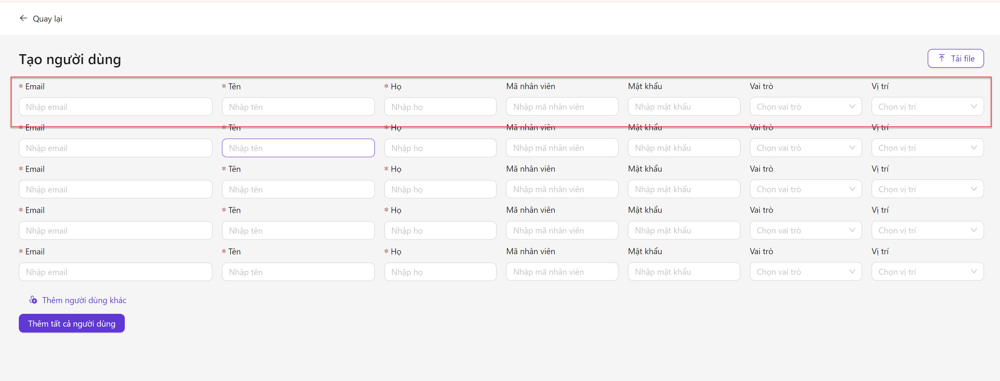
    </Frame>
  </Step>
  <Step title="Bước 2: Lưu tài khoản">
    Điền đầy đủ thông tin nhân sự cần thêm vào hệ thống và bấm "Thêm tất cả người dùng". Chú ý chọn đầy đủ vị trí, Vai trò và có thể điền mật khẩu mặc định của người dùng.

    <Frame caption="Điền đầy đủ thông tin người dùng và lưu lại.">
      
    </Frame>
  </Step>
  <Step title="Bước 3: Thêm vào nhóm chấm công">
    Sau khi đã tạo thành công tài khoản của người dùng. Truy cập vào Menu Ứng dung → Clock → Cài đặt. Chọn "Nhóm 

    <Frame caption="Chọn Ứng dụng Clock">
      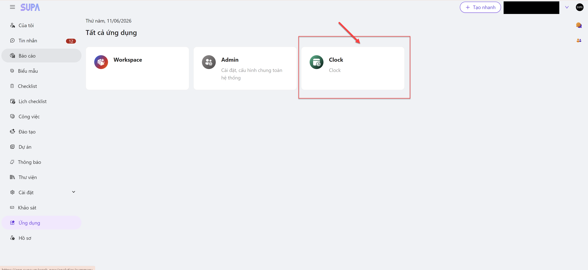
    </Frame>

    <Frame caption='Chọn "Nhóm chấm công" muốn thêm người dùng vào, chọn trực tiếp theo địa điểm làm việc hoặc nếu làm nhiều địa điểm thì chọn Nhóm làm nhiều'>
      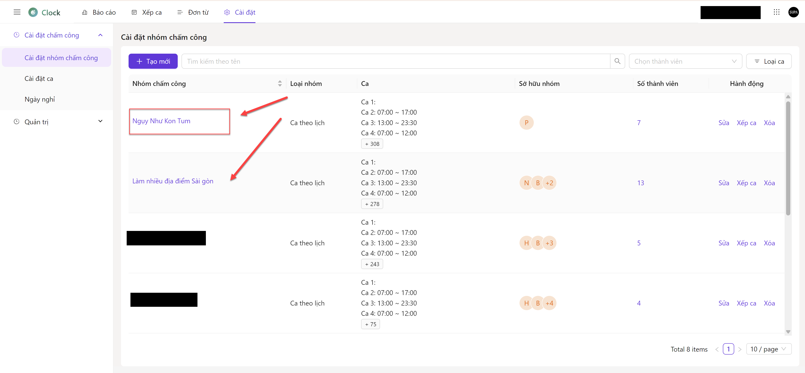
      
    </Frame>

    <Frame caption="Chọn người dùng vừa thêm vào nhóm và Lưu lại chọn Áp dụng ngay lập tức.">
      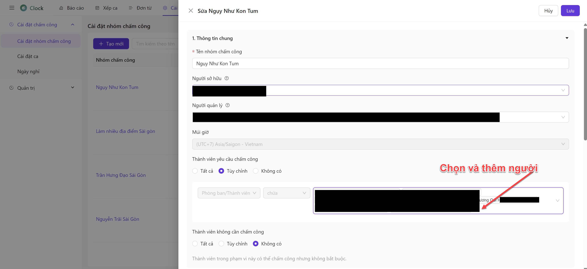
    </Frame>
  </Step>
  <Step title="Bước 4: Xếp ca">
    Để nhân viên có thể chấm công được bắt buộc quản lý và người có quyền ở Nhóm chấm công tương ứng sẽ phải "Xếp ca" cho nhân viên mới có thể chấm công.  Truy cập vào Menu Ứng dụng → Clock → Xếp ca.

    <Frame caption="Có thể vào từng ngày và từng dòng để thêm ca cho nhân sự hoặc Upload Excel.">
      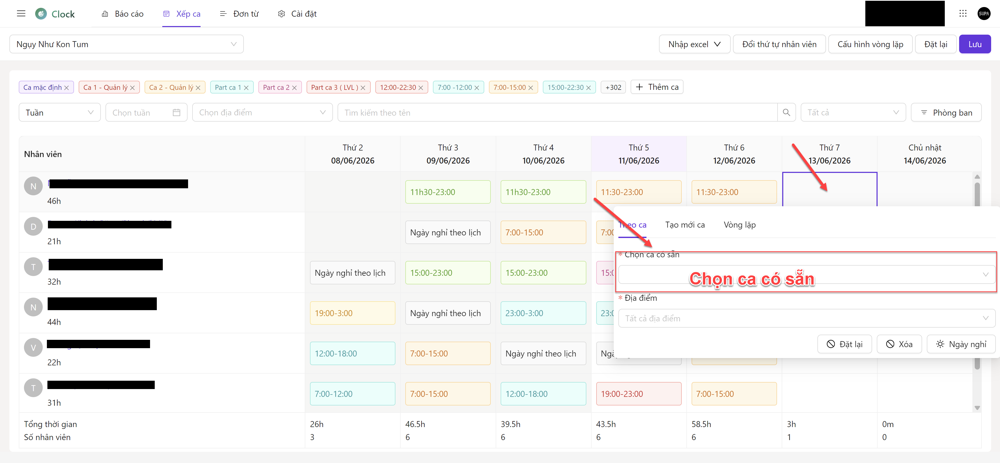
    </Frame>

    <Frame>
      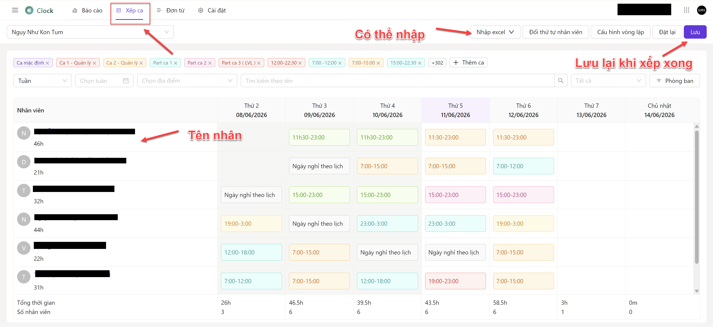
    </Frame>
  </Step>
</Steps>

Chức năng **Xếp ca** giúp quản lý lên lịch làm việc cho nhân viên theo tuần, tháng hoặc ngày trên một bảng duy nhất: ai làm ca nào, ở địa điểm nào, tổng số giờ và số nhân viên mỗi ngày. Tài liệu này hướng dẫn từng bước từ đăng nhập, làm quen màn hình đến xếp ca nhanh bằng vòng lặp và Excel.

## 1. Đăng nhập Supa và mở Clock

<Steps>
  <Step title="Bước 1">
    Mở trình duyệt và truy cập [**https://app.supa.vn**](https://app.supa.vn).
  </Step>
  <Step title="Bước 2">
    Nhập **Email đăng nhập** và **Mật khẩu**, rồi bấm **Đăng nhập**. Bạn cũng có thể chọn **Đăng nhập với Google** hoặc **Đăng nhập với Microsoft**. Nếu quên mật khẩu, bấm **Quên mật khẩu?**.
  </Step>
  <Step title="Bước 3">
    Sau khi đăng nhập, bấm nút **6 chấm** ở góc trên bên phải, cạnh ảnh đại diện, để mở danh sách ứng dụng.
  </Step>
  <Step title="Bước 4">
    Chọn **Clock**. Thanh menu phía trên của Clock gồm **Báo cáo**, **Xếp ca**, **Đơn từ** và **Cài đặt**.
  </Step>
</Steps>

<Frame caption="Trang đăng nhập Supa tại app.supa.vn">
  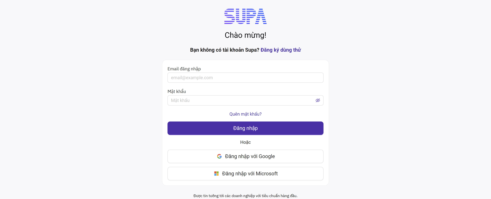
</Frame>

<Frame caption="Bấm nút 6 chấm ở góc phải để mở danh sách ứng dụng, rồi chọn Clock">
  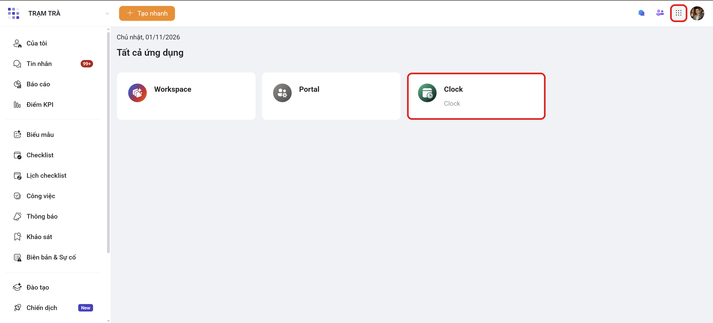
</Frame>

<Note>
  

  

  Nếu chưa có tài khoản, bấm **Đăng ký dùng thử** ngay trên trang đăng nhập.
</Note>

## 2. Truy cập màn hình Xếp ca

<Steps>
  <Step title="Bước 1">
    Trong ứng dụng **Clock**, trên thanh menu phía trên, chọn **Xếp ca**.
  </Step>
  <Step title="Bước 2">
    Ở góc trên bên trái, chọn **nhóm chấm công** cần xếp ca (ví dụ nhóm làm nhiều địa điểm hoặc nhóm theo từng địa điểm). Bảng xếp ca sẽ hiển thị nhân viên thuộc nhóm đó.
  </Step>
</Steps>

<Frame caption="Màn hình Xếp ca: thanh ca, bộ lọc và bảng xếp ca theo tuần">
  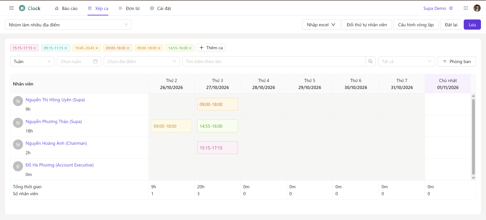
</Frame>

<Frame caption="Chọn nhóm chấm công ở góc trên bên trái">
  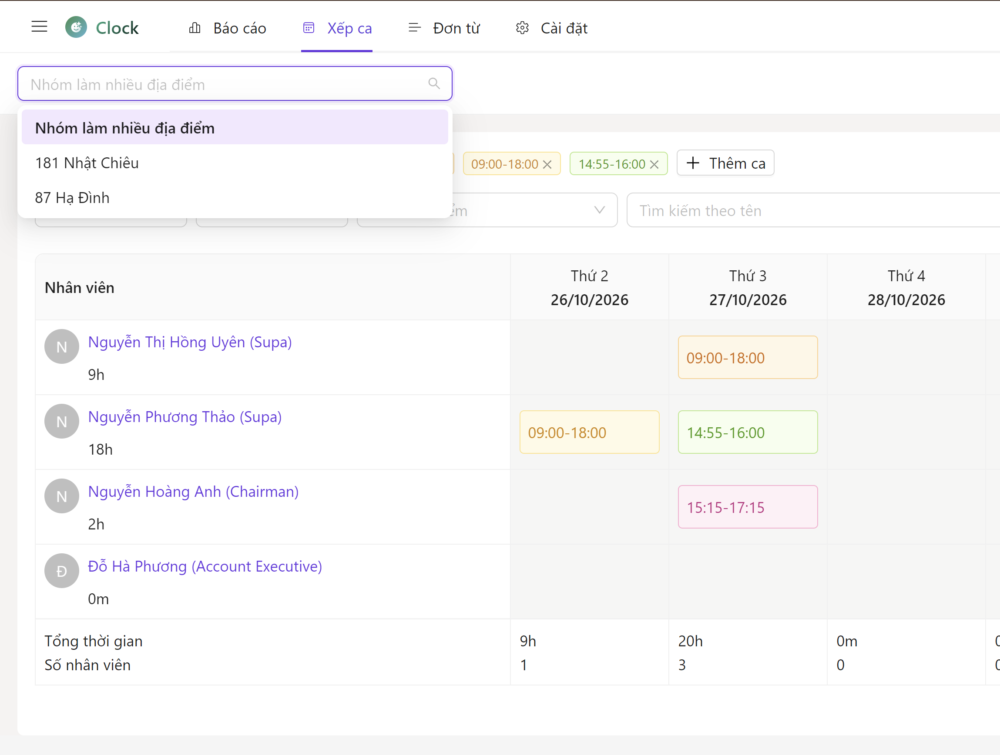
</Frame>

## 3. Làm quen với màn hình

| Khu vực | Ý nghĩa |
| --- | --- |
| Nhóm chấm công (góc trên trái) | Chọn nhóm nhân viên cần xếp ca. |
| Nút Nhập excel | Tải file mẫu và nhập lịch xếp ca từ Excel. |
| Nút Đổi thứ tự nhân viên | Sắp xếp lại thứ tự hiển thị nhân viên trên bảng. |
| Nút Cấu hình vòng lặp | Tạo và quản lý các mẫu lặp ca theo ngày hoặc theo tuần. |
| Nút Đặt lại / Lưu | Hủy các thay đổi chưa lưu / lưu lịch xếp ca. |
| Thanh ca (thẻ màu) | Các ca đang dùng để xếp, kèm nút **Thêm ca**. |
| Bộ lọc | Chế độ xem (Theo Tháng / Theo Tuần / Theo Ngày), chọn tuần, địa điểm, tìm theo tên, phòng ban. |
| Bảng xếp ca | Mỗi hàng là một nhân viên (kèm tổng giờ), mỗi cột là một ngày. |
| Hai dòng cuối bảng | **Tổng thời gian** và **Số nhân viên** làm việc của từng ngày. |

Bộ lọc đầu tiên chọn **chế độ xem**: **Theo Tuần** (mỗi cột là một ngày trong tuần, chọn tuần ở ô bên cạnh), **Theo Tháng** (mỗi cột là một ngày trong tháng, kéo ngang để xem hết) hoặc **Theo Ngày** (xem theo từng giờ trong một ngày).

<Frame caption="Chế độ xem Theo Tháng">
  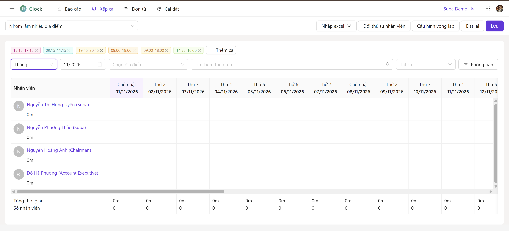
</Frame>

<Frame caption="Chế độ xem Theo Ngày: các cột là giờ trong ngày">
  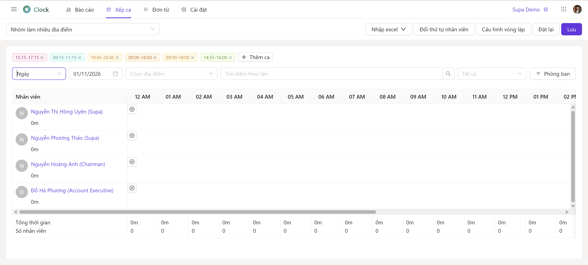
</Frame>

<Note>
  Các ô thuộc ngày đã qua hiển thị nền xám và không mở được cửa sổ gán ca. Ô của ngày hiện tại được tô nổi bật ở tiêu đề cột.
</Note>

## 4. Chọn ca hiển thị trên thanh ca (Thêm ca)

Thanh ca phía trên bảng là danh sách ca bạn đang dùng để xếp. Bạn có thể thêm hoặc bỏ ca khỏi thanh này.

<Steps>
  <Step title="Bước 1">
    Bấm **\+ Thêm ca**.
  </Step>
  <Step title="Bước 2">
    Trong hộp thoại **Ca**, tìm theo tên ca hoặc lọc, rồi đánh dấu chọn các ca muốn dùng.
  </Step>
  <Step title="Bước 3">
    Bấm **Sửa** ở cuối dòng để chỉnh một ca có sẵn, hoặc **Tạo ca mới** để tạo ca mới.
  </Step>
  <Step title="Bước 4">
    Đóng hộp thoại. Các ca đã chọn xuất hiện thành thẻ màu trên thanh ca. Bấm dấu **×** trên thẻ để bỏ ca khỏi thanh.
  </Step>
</Steps>

<Frame caption="Hộp thoại Ca: chọn ca, Sửa hoặc Tạo ca mới">
  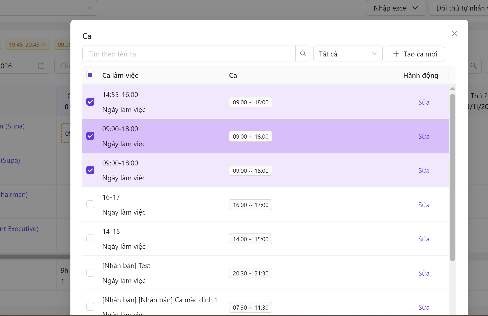
</Frame>

## 5. Gán ca cho nhân viên

Đây là thao tác chính. Bạn gán ca bằng cách bấm vào ô giao giữa nhân viên và ngày.

<Steps>
  <Step title="Bước 1">
    Chọn chế độ xem và tuần cần xếp bằng bộ lọc phía trên bảng.
  </Step>
  <Step title="Bước 2">
    Bấm vào ô của nhân viên ở ngày cần xếp. Cửa sổ gán ca hiện ra với 3 tab: **Theo ca**, **Tạo mới ca**, **Vòng lặp**.
  </Step>
  <Step title="Bước 3">
    Ở tab **Theo ca**, mở **Chọn ca có sẵn** và chọn ca. Hệ thống hiển thị giờ làm và loại ngày của ca.
  </Step>
  <Step title="Bước 4">
    Chọn **Địa điểm** làm việc.
  </Step>
  <Step title="Bước 5">
    Ô trên bảng hiện ca ở dạng khung nét đứt (bản nháp), đồng thời **Tổng thời gian** và **Số nhân viên** của ngày cập nhật ngay.
  </Step>
  <Step title="Bước 6">
    Bấm **Lưu** (góc trên bên phải) để áp dụng chính thức.
  </Step>
</Steps>

<Frame caption="Cửa sổ gán ca, tab Theo ca">
  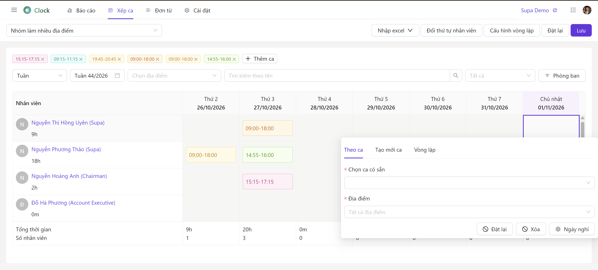
</Frame>

<Frame caption="Danh sách ca có sẵn để chọn">
  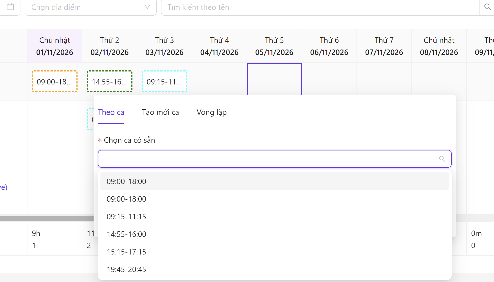
</Frame>

<Frame caption="Ca vừa chọn hiển thị ở dạng nháp nét đứt, tổng giờ đã cập nhật">
  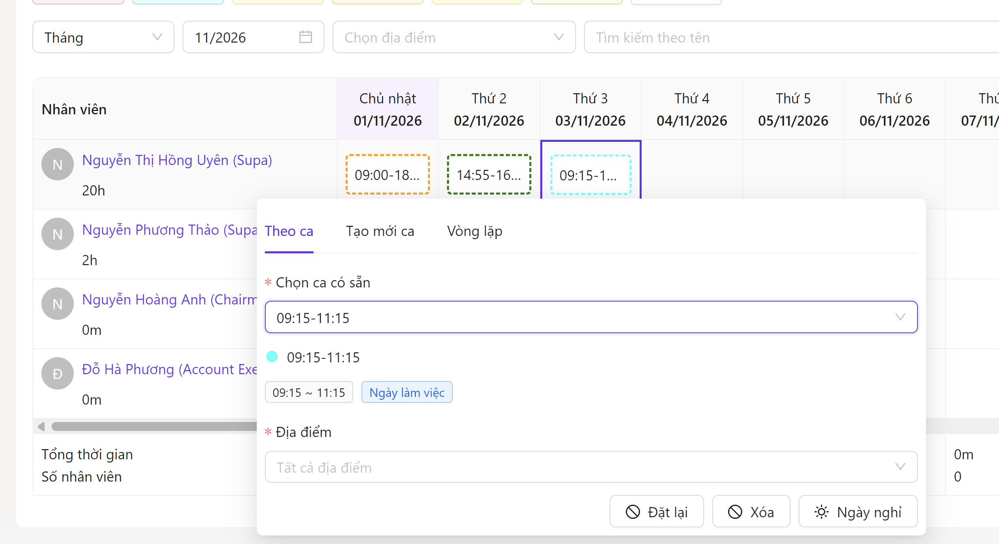
</Frame>

Ba nút ở cuối cửa sổ gán ca:

- **Đặt lại**: bỏ thay đổi ở ô đang chọn.
- **Xóa**: xóa ca đã xếp trong ô.
- **Ngày nghỉ**: đánh dấu nhân viên nghỉ ngày đó.

<Note>
  Ca chỉ được ghi nhận chính thức sau khi bạn bấm **Lưu**.
</Note>

## 6. Tạo ca mới ngay tại ô

Khi chưa có ca phù hợp, bạn tạo ca mới ngay trong cửa sổ gán ca mà không cần ra ngoài.

<Steps>
  <Step title="Bước 1">
    Bấm vào ô cần xếp, chuyển sang tab **Tạo mới ca**.
  </Step>
  <Step title="Bước 2">
    Nhập **Tên ca** và chọn **Loại ngày** (ví dụ Ngày làm việc).
  </Step>
  <Step title="Bước 3">
    Thiết lập **Bắt đầu tính giờ** và **Kết thúc tính giờ** (chọn Cùng ngày hoặc ngày khác, giờ cụ thể). Có thể bật hoặc tắt **Check in / Check out**.
  </Step>
  <Step title="Bước 4">
    Bấm **Thêm khoảng thời gian** nếu ca chia nhiều khoảng (ví dụ ca gãy).
  </Step>
  <Step title="Bước 5">
    Đánh dấu **Thiết lập thời gian nghỉ** nếu ca có giờ nghỉ.
  </Step>
  <Step title="Bước 6">
    Chọn **Địa điểm**, xác nhận rồi bấm **Lưu** để áp dụng.
  </Step>
</Steps>

<Frame caption="Tab Tạo mới ca: tên ca, loại ngày, giờ bắt đầu và kết thúc">
  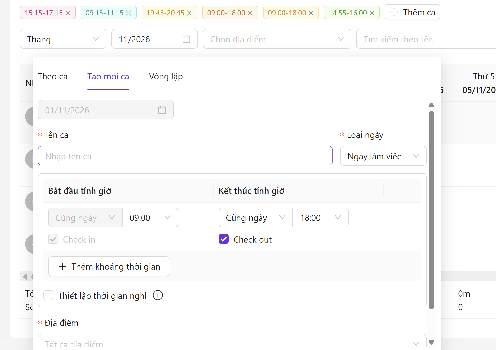
</Frame>

## 7. Xếp ca nhanh bằng vòng lặp

Vòng lặp là mẫu ca lặp theo chu kỳ, phù hợp khi nhiều nhân viên có lịch giống nhau mỗi tuần.

**7.1. Tạo vòng lặp**

<Steps>
  <Step title="Bước 1">
    Bấm **Cấu hình vòng lặp** ở thanh công cụ. Ngăn **Vòng lặp** hiện danh sách các vòng lặp đã có (cột Vòng lặp, Loại, Ca, Hành động).
  </Step>
  <Step title="Bước 2">
    Bấm **Tạo mới**.
  </Step>
  <Step title="Bước 3">
    Nhập **Tên vòng lặp** (bắt buộc).
  </Step>
  <Step title="Bước 4">
    Chọn **Loại vòng lặp**: **Lập theo ngày** (Ngày 1, Ngày 2, ... bấm **Thêm dòng** để tăng số ngày trong chu kỳ) hoặc **Lập theo tuần** (chọn ca cho từng thứ từ Thứ 2 đến Chủ nhật).
  </Step>
  <Step title="Bước 5">
    Chọn ca làm việc cho từng ngày hoặc từng thứ trong chu kỳ.
  </Step>
  <Step title="Bước 6">
    Chọn **Ghi đè lên các ca đã được lên lịch**: **Có** (thay ca đã xếp trước đó) hoặc **Không** (giữ nguyên ca đã xếp).
  </Step>
  <Step title="Bước 7">
    Bấm **Lưu**.
  </Step>
</Steps>

<Frame caption="Danh sách vòng lặp: Sửa, Xóa, Tạo mới">
  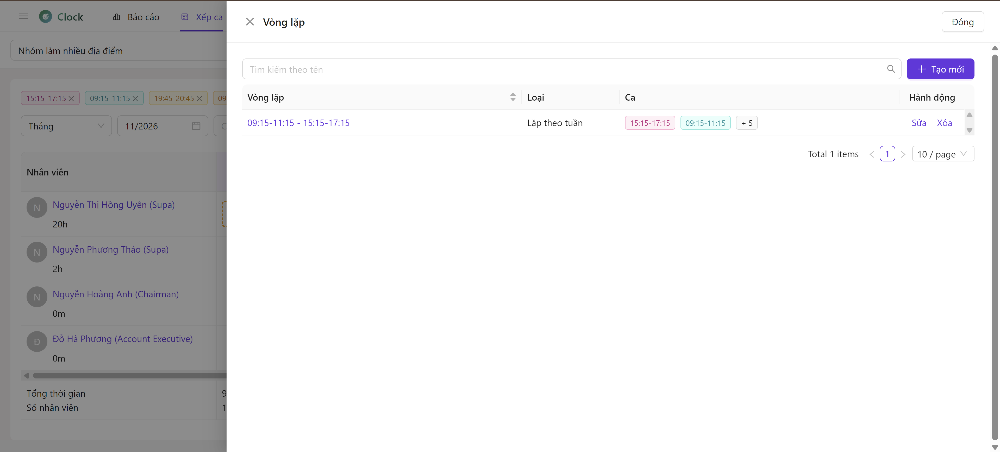
</Frame>

<Frame caption="Tạo vòng lặp theo ngày">
  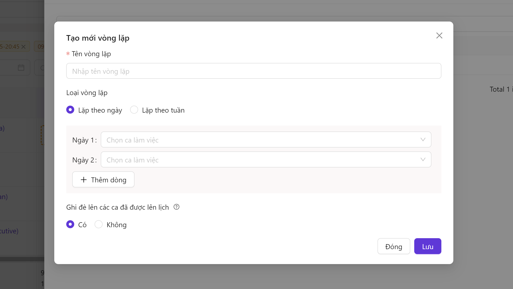
</Frame>

<Frame caption="Tạo vòng lặp theo tuần (Thứ 2 đến Chủ nhật)">
  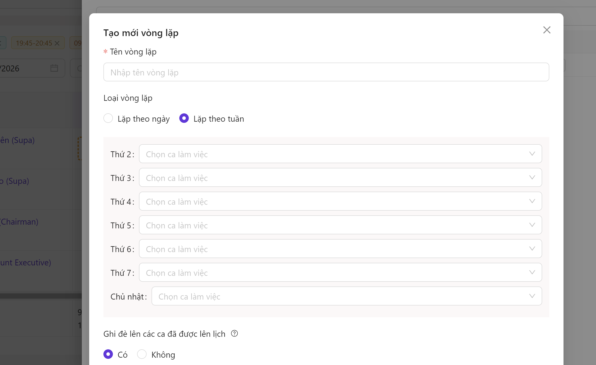
</Frame>

**7.2. Áp dụng vòng lặp cho nhân viên**

<Steps>
  <Step title="Bước 1">
    Bấm vào ô của nhân viên, chọn tab **Vòng lặp**.
  </Step>
  <Step title="Bước 2">
    Chọn vòng lặp và **Địa điểm**.
  </Step>
  <Step title="Bước 3">
    Bấm **Tạo lịch** để sinh lịch theo mẫu. Nếu cần vòng lặp mới, bấm **Thêm vòng lặp**.
  </Step>
  <Step title="Bước 4">
    Kiểm tra lại bảng rồi bấm **Lưu**.
  </Step>
</Steps>

<Frame caption="Tab Vòng lặp trong cửa sổ gán ca">
  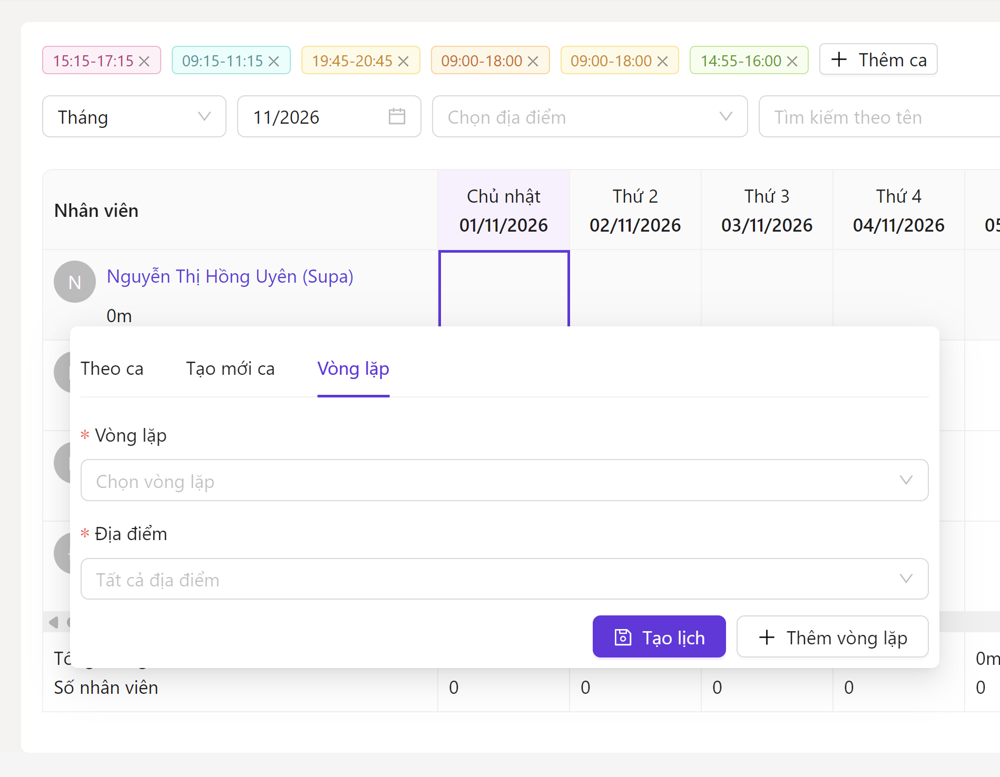
</Frame>

<Tip>
  Với các ca cố định hằng tuần (ví dụ cửa hàng mở cùng giờ), tạo một vòng lặp theo tuần rồi áp dụng cho từng nhân viên sẽ nhanh hơn gán từng ô.
</Tip>

## 8. Nhập lịch xếp ca từ Excel

<Steps>
  <Step title="Bước 1">
    Bấm **Nhập excel**.
  </Step>
  <Step title="Bước 2">
    Chọn **Tải xuống mẫu** để tải file Excel mẫu.
  </Step>
  <Step title="Bước 3">
    Điền lịch xếp ca vào file mẫu theo đúng cấu trúc cột.
  </Step>
  <Step title="Bước 4">
    Bấm **Nhập excel**, chọn **Nhập file xếp ca** và chọn file vừa điền.
  </Step>
  <Step title="Bước 5">
    Kiểm tra kết quả trên bảng rồi bấm **Lưu**.
  </Step>
</Steps>

## 9. Đổi thứ tự hiển thị nhân viên

<Steps>
  <Step title="Bước 1">
    Bấm **Đổi thứ tự nhân viên**.
  </Step>
  <Step title="Bước 2">
    Kéo thả biểu tượng ở đầu mỗi dòng để sắp xếp lại nhân viên.
  </Step>
  <Step title="Bước 3">
    Bấm **Lưu** trong ngăn này. Thứ tự mới được áp dụng trên bảng xếp ca.
  </Step>
</Steps>

<Frame caption="Kéo thả để đổi thứ tự nhân viên">
  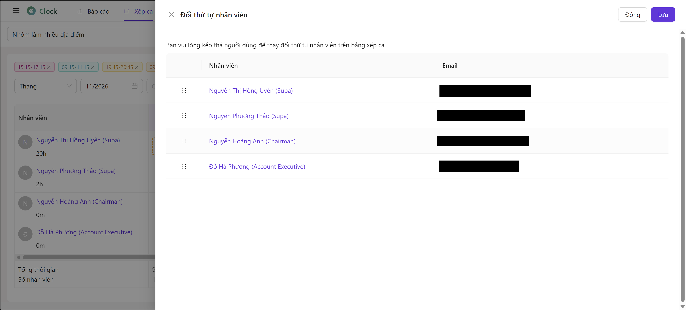
</Frame>

## 10. Lưu và hủy thay đổi

- **Lưu**: ghi nhận toàn bộ thay đổi vào hệ thống.
- **Đặt lại**: xóa các thay đổi chưa lưu và quay về lịch đã lưu gần nhất.

<Note>
  Hãy bấm **Lưu** trước khi chuyển tuần hoặc rời khỏi trang.
</Note>

## Câu hỏi thường gặp

**Vì sao tôi không bấm được vào một số ô?**
 Các ô thuộc ngày đã qua hiển thị nền xám và không chỉnh sửa được.

**Tổng giờ của nhân viên hiển thị ở đâu?**
 Dưới tên mỗi nhân viên ở cột đầu tiên. Tổng giờ và số nhân viên theo ngày nằm ở hai dòng cuối bảng.

**Muốn xếp cho nhiều địa điểm thì làm thế nào?**
 Chọn nhóm chấm công nhiều địa điểm, sau đó chọn Địa điểm khi gán ca cho từng nhân viên.
